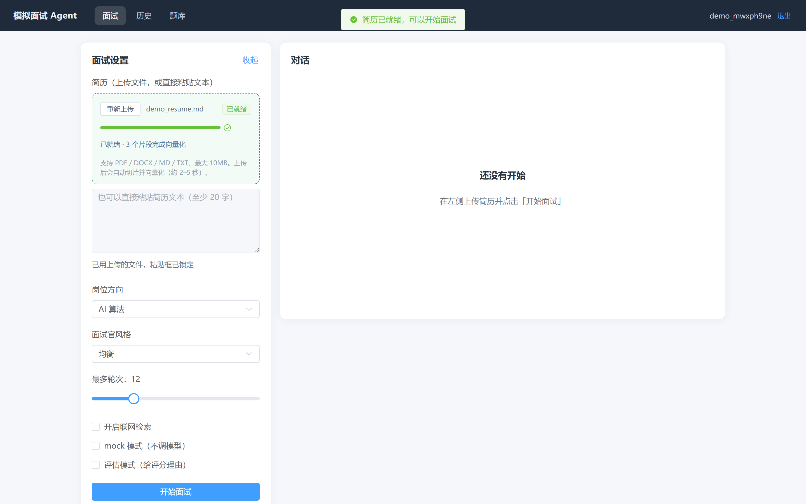
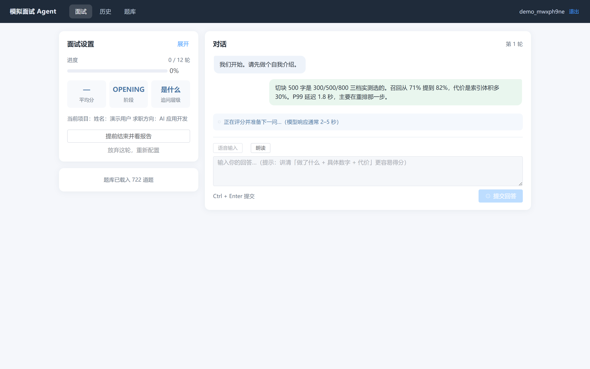
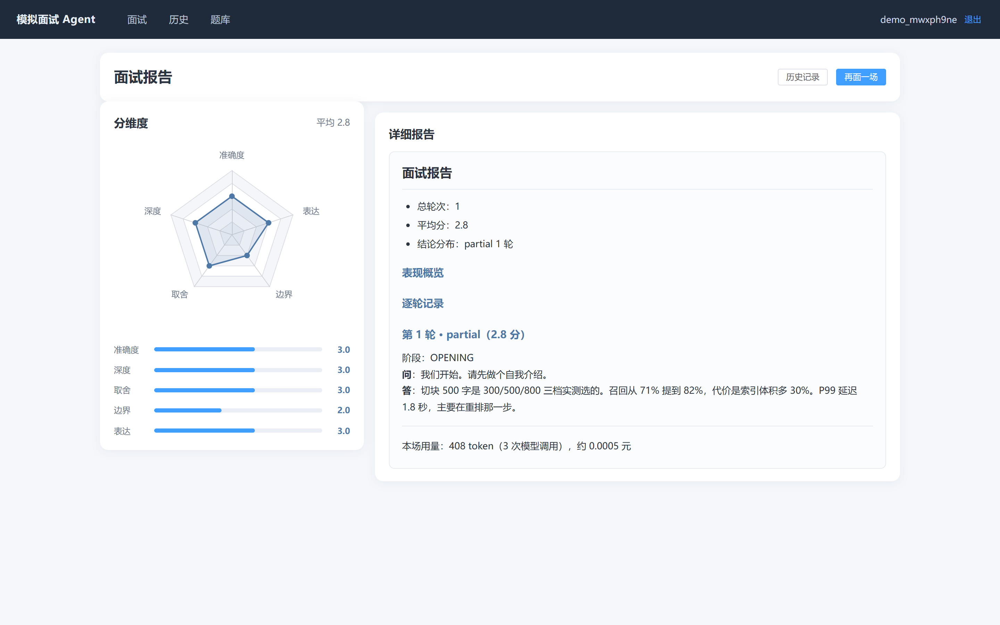
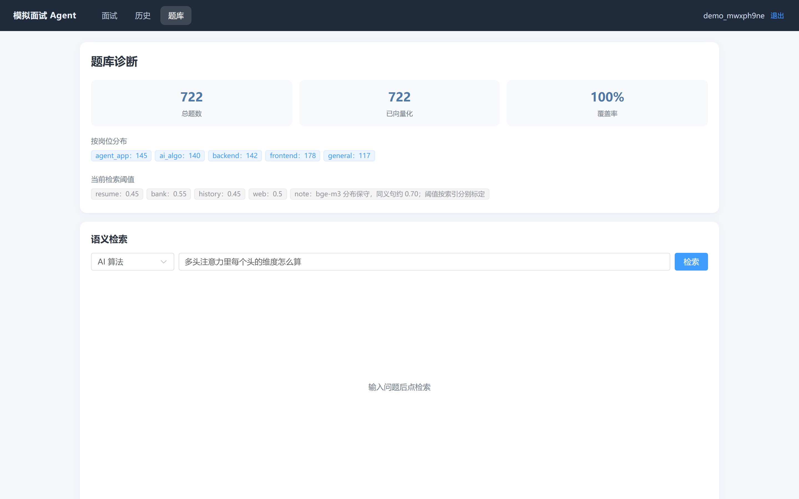
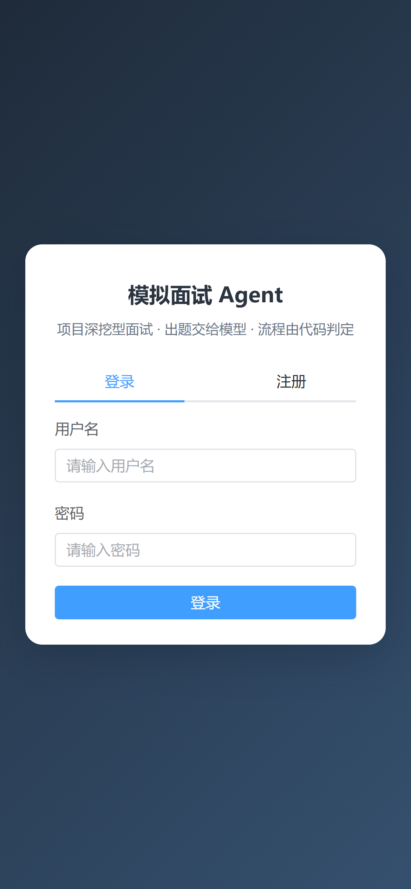

# 模拟面试 Agent

[](https://github.com/LiQingfeng111/interview-agent/actions/workflows/ci.yml)
[](https://www.python.org/)
[](https://vuejs.org/)
[](LICENSE)

> 一个**项目深挖型**的模拟面试系统：状态机控制节奏，简历驱动追问，五维打分可回溯。

不是"跟 AI 聊天的面试机器人"。核心区别在于：**出题节奏由代码决定，模型只负责措辞。**

**跑起来后打开** → http://localhost:5173 （本机开发） / http://localhost:8081 （Docker）
详见 [快速开始](#快速开始)。

---

## 界面一览

<table>
<tr>
<td width="50%">

**① 登录**

JWT 双 token：access 15 分钟在内存（防 XSS 偷走），
refresh 7 天在 HttpOnly Cookie（JS 读不到）。


</td>
<td width="50%">

**② 面试配置**

上传简历 → 自动切片 + 向量化 → 就绪后按钮才可点。



</td>
</tr>
<tr>
<td>

**③ 上传进度**

六阶段人话反馈，用户永远知道现在在干什么。

上传 → 已收到 → 解析中 → 向量化 3/8 → 就绪


</td>
<td>

**④ 面试对话**

左侧实时进度 / 阶段 / 追问层级，右侧问答气泡带评分徽标。



</td>
</tr>
<tr>
<td>

**⑤ 报告**

五维雷达 + 分维度条形 + Markdown 报告 + token 成本。

雷达图数据来自 `turns` 表的独立列（不是 JSON），能按维度聚合。



</td>
<td>

**⑥ 题库**

722 道题，纯语义检索（不做关键词混合，实测 17/18 vs 10/18）。



</td>
</tr>
<tr>
<td>

**⑦ 历史**

往期面试记录，可回看报告。


</td>
<td>

**⑧ 移动端**

响应式布局，未做专门适配但可用。



</td>
</tr>
</table>

> 这些截图是**脚本自动生成**的：`node frontend/scripts/screenshot.mjs`
> UI 改了重跑一次就更新，不会忘记同步文档。

---

## 为什么做这个

市面上的 AI 模拟面试，问题高度雷同：

| 常见做法 | 问题 |
|---|---|
| 一个大模型 + 一段提示词 | 问完第一题就开始重复；问到哪儿了不知道 |
| 模型自己决定问什么 | 说不清"为什么问这题"，也没法验证改进了没有 |
| 只给一个总分 | "3.5 分"没有信息量，不知道弱在哪 |

**这个项目的取舍**：把"节奏"和"判断"交给确定性代码，把"措辞"交给模型。

```
候选人的一句话
    │
    ├─→ 状态机：现在该问什么阶段（开场/项目深挖/技术问答/反问）
    ├─→ 追问树：这个项目还有哪 3 个要素没问到（目标/基线/指标/失败方案/个人贡献）
    ├─→ 难度梯子：当前停在第几层（是什么/为什么/怎么做/取舍/边界/反事实）
    └─→ 检索：简历里相关的片段、题库里语义相近的题
            │
            └─→ 模型：把以上约束写成一句人话
```

**这样做的代价**：写得比"一个提示词"复杂得多。
**换来的好处**：每条追问都能解释"为什么问这个"，每一分都能追溯到具体维度。

---

## 技术栈

| 层 | 选型 | 为什么 |
|---|---|---|
| 后端 | Python 3.12 + FastAPI | 异步友好，OpenAPI 自动生成 |
| 编排 | LangGraph（`StateGraph` + `PostgresSaver`） | 会话状态持久化，进程重启能续跑 |
| 模型 | LangChain + OpenAI 兼容接口 | 模型可换（本地/云端），不强绑一家 |
| 向量 | PostgreSQL + pgvector + bge-m3 | 一套库解决关系 + 向量，不用额外装 ES |
| 缓存 | Redis | 会话热态、限流 |
| 前端 | Vue 3 + TypeScript + Element Plus | 组合式 API，类型安全 |
| 部署 | Docker Compose | 一条命令起全栈 |

**核心逻辑与模型解耦**：`state_machine.py` / `probe_tree.py` / `invariants.py` /
`ledger.py` / `evaluator.py` 都是纯 Python，不 import 任何模型客户端。
这样规则层能在测试里稳定跑，也是"为什么问这题"能被解释的前提。

---

## 快速开始

### 前置

- Docker（跑 PostgreSQL + Redis）
- Python 3.12
- Node.js **22+**（`undici` / `vitest` 的要求；Node 20 会崩）
- （可选）[Ollama](https://ollama.com/) 跑本地向量模型 `bge-m3`

### 三行命令

```bash
# 1. 装依赖
python3 -m venv .venv && .venv/bin/pip install -r backend/requirements.txt
cd frontend && npm install && cd ..

# 2. 配环境（只需要填 LLM_API_KEY）
cp .env.example .env

# 3. 启动
bash start.sh
```

### 起来之后打开哪个地址 ← **看这里**

启动完访问 **http://localhost:5173**（前端界面）。

| 地址 | 是什么 | 什么时候用 |
|---|---|---|
| **http://localhost:5173** | **前端界面** | **平时用这个** |
| http://localhost:8080/docs | 后端 API 文档（Swagger） | 想直接调接口、看有哪些端点 |
| http://localhost:8080/api/health | 健康检查（JSON） | 排查问题：各组件是否就绪 |

**端口分配**（两个模式不一样，别混）：

| 模式 | 前端 | 后端 |
|---|---|---|
| 本机开发（`bash start.sh`） | **5173** | 8080 |
| Docker 全栈（`docker compose up`） | **8081** | 8080 |

> Docker 里前端是 8081（容器内 Nginx 的 80 映射出来），
> 本机开发是 Vite 的 5173。两个同时跑不会冲突。

**改端口**：

```bash
IA_PORT=9000 bash start.sh api          # 后端改 9000
cd frontend && npm run dev -- --port 3000   # 前端改 3000
```

前端开发时通过 Vite proxy 转发 `/api` 到 `127.0.0.1:8080`（见 `frontend/vite.config.ts`），
所以前端改端口不影响后端连通；但**后端改端口时要同步改 vite 的 proxy target**。

### 启动过程中会发生什么

`start.sh` 按顺序做这些事，每步都有输出：

```
▸ 环境体检      Python / 依赖 / Ollama / 密钥
▸ PostgreSQL    起容器（首次会创建）→ 等就绪
▸ 后端 API      建表 → 导入题库 722 题（约 18 秒）→ 起 uvicorn
▸ 前端          检查依赖 → 提示在 Windows 侧启动
```

**Windows 用户**：双击 `start.bat`（会调 `start.sh` 并额外开窗口跑前端，最后自动打开浏览器）。

### 遇到问题

```bash
bash start.sh check     # 环境体检（不动任何东西）
bash start.sh status    # 看服务状态和数据量
bash start.sh stop      # 停掉后端和前端
```

体检输出示例：

```
▸ 环境体检
  ✓ Python venv: Python 3.12.3
  ✓ 后端依赖已装
  ! PostgreSQL 容器存在但未运行（start.sh 会自动启动）
  ✓ Ollama（172.22.48.1:11800）
  ✓ 模型网关（172.22.48.1:18336）
  ✓ LLM_API_KEY 已配置
  ✓ 前端依赖已装
  基础环境就绪，可以 bash start.sh
```

---

## 页面清单

截图已集中在上方「界面一览」，这里是功能说明。

| 页面 | 说明 |
|---|---|
| 登录 / 注册 | JWT 双 token（access 15 分钟在内存，refresh 7 天在 HttpOnly Cookie） |
| 面试 | 左：简历上传 + 配置；右：对话 + 实时评分 |
| 报告 | 五维雷达图 + 逐轮记录 + 成本 |
| 历史 | 往期面试列表，可回看报告 |
| 题库 | 722 题检索（纯语义） |
| 管理 | 用户管理、阈值调参、RAG 诊断 |

**几个实现细节**：

- **简历上传六阶段反馈**：用户永远知道现在在干什么，不会以为卡住而反复点。
- **语音**：浏览器原生 ASR/TTS（Chrome/Edge 零延迟、免费、内容不外传），后端留了 Whisper/edge-tts 作为 Firefox 兜底。
- **评估模式**：勾选后每轮回答完显示「扣分点 / 缺什么 / 建议 / 可以这样说」。
- **报告 Markdown 渲染带 XSS 清洗**：报告是模型生成的，属于不可信输入，直接 `v-html` 会被注入。用 marked + DOMPurify，8 条测试覆盖常见 payload。
- **截图脚本自动生成**：`node frontend/scripts/screenshot.mjs`，UI 改了重跑一次就更新。

---

## 设计上几个关键决定

### 1. 判定权在阈值，不在模型

模型会返回一个 `verdict`（pass / partial / fail）。但**我们不用它**。

```python
# 阈值说话
if avg >= 2.8:   verdict = "pass"        # real 模式
elif avg >= 1.6: verdict = "partial"
else:            verdict = "fail"

# 模型的判定只留档，用来发现"尺子和模型不一致"
model_verdict = llm_output["verdict"]
if model_verdict != verdict:
    flag("verdict_conflict")   # 提示词或阈值需要复核
```

**为什么**：模型的判定会漂移（同样答案两次可能一个 pass 一个 partial）。
留档冲突是为了**发现问题**，不是让它参与决策。

### 2. 检索用纯语义，不做关键词混合

试过三种，在同一批 18 条查询上测：

| 方案 | 命中 |
|---|---|
| 纯向量（bge-m3） | **17 / 18** |
| 纯关键词 | 7 / 18 |
| RRF 混合 | 10 / 18 |

RRF 反而更差，因为关键词那一路拖后腿。所以**只留向量**。

### 3. 阈值按"用途"分，不按"索引"分

同一份向量，不同用途的相似度分布不一样：

| 用途 | 阈值 | 理由 |
|---|---|---|
| 去重 | 0.60 | 判定"是不是同一题"，要严 |
| 选题 | 0.42 | 判定"够不够相关"，可以松 |
| 提示 | 0.42 | 同上 |

bge-m3 的分布很保守：同义改写约 0.70，不相关约 0.40，**正负样本间隔只有 0.022**。
所以阈值必须实测标定，不能拍脑袋。

### 4. 重启能续跑

会话状态用 `PostgresSaver` 持久化。进程被杀后重启，从**第 3 轮**继续，不是从 0 开始。

实测：

```
前 3 轮: tokens=802  calls=7
━━━ 杀进程 → 重启 ━━━
后 3 轮: tokens=1504 calls=13   ← 跨重启累积正确
```

---

## 项目结构

```
interview_agent/
├── start.sh / start.bat      ← 唯一入口
├── ops.sh                    ← 运维（db/schema/bank/api/status/e2e/test）
├── *.py                      ← 规则层（零依赖，可单独测试）
│   ├── state_machine.py        阶段推进
│   ├── probe_tree.py           追问要素树
│   ├── invariants.py           8 条运行时约束
│   ├── ledger.py               追加式账本 + 哈希链
│   ├── evaluator.py            五维评分
│   └── interviewer.py          措辞生成
│
├── backend/
│   ├── app/
│   │   ├── api/                FastAPI 路由（31 个端点）
│   │   ├── graph/              LangGraph 编排
│   │   ├── rag/                检索（embedder/splitter/retriever/记忆）
│   │   ├── repos/              PG + Redis
│   │   └── core/               运行时/自检/成本
│   └── tests/                  55 条测试
│
├── frontend/
│   └── src/                    Vue 3（19 文件）
│
├── docs/                       设计文档（见下）
└── legacy/                     已废弃的旧架构（不入库）
```

**规模**：约 17,000 行（规则层 7,476 / 后端 6,542 / 前端 3,018）

---

## 测试

```bash
pytest                    # 411 passed, 1 skipped
cd frontend && npm test   # 18 passed
```

| 层 | 条数 | 需要什么 |
|---|---|---|
| 规则层 `tests/` | 343 | 只需 Python（不连数据库/模型） |
| 后端 `backend/tests/` | 68 | PostgreSQL；检索测试需要 Ollama |
| 前端 `frontend/src/**/*.test.ts` | 18 | Node |

覆盖的重点：

- **规则层不依赖模型**：状态机、追问树、不变量、账本校验都是纯函数，好测
- **鉴权**：篡改 token / 换密钥签 / 过期 / access-refresh 混用 —— 全部必须被拒
- **阈值回归**：检索阈值有一组固定的查询/期望，改动会立刻发现
- **重启恢复**：`test_restart_recovery.sh` 真的杀进程再续跑

CI（`.github/workflows/ci.yml`）跑三组独立 job：规则层 / 后端（带 PostgreSQL service）/ 前端（类型检查 + 测试 + 构建）。

---

## 已知限制

诚实列出来，不粉饰：

| 项 | 原因 | 影响 |
|---|---|---|
| 后端 ASR 需联网下模型 | Whisper 模型 140MB，当前网络取不到 | Firefox 无语音输入（Chrome/Edge 用浏览器原生） |
| 成本是估算值 | 从 LLM logger 读 usage，并发会话可能串账 | 数字有偏差，量级正确 |
| 移动端未适配 | 只测了桌面浏览器 | 手机上布局会错位 |
| 单进程部署 | 会话热态在进程内存 | 多实例需要把热态换到 Redis |

---

## 文档

| 文档 | 内容 |
|---|---|
| [PRODUCT-PLAN.md](docs/PRODUCT-PLAN.md) | 产品定位与路线 |
| [API-CONTRACT.md](docs/API-CONTRACT.md) | 31 个端点的契约 |
| [ERROR-DESIGN.md](docs/ERROR-DESIGN.md) | 错误码设计（40xxx–5xxxx） |
| [PROMPT-TEMPLATES.md](docs/PROMPT-TEMPLATES.md) | 提示词模板与为什么这么写 |
| [DEDUP-RESEARCH.md](docs/DEDUP-RESEARCH.md) | 检索方案对比实验 |
| [ARCHITECTURE-MAP.md](docs/ARCHITECTURE-MAP.md) | 架构地图 |
| [backend/docs/](backend/docs/) | 各阶段实现报告（含踩坑记录） |

---

## 许可

MIT
