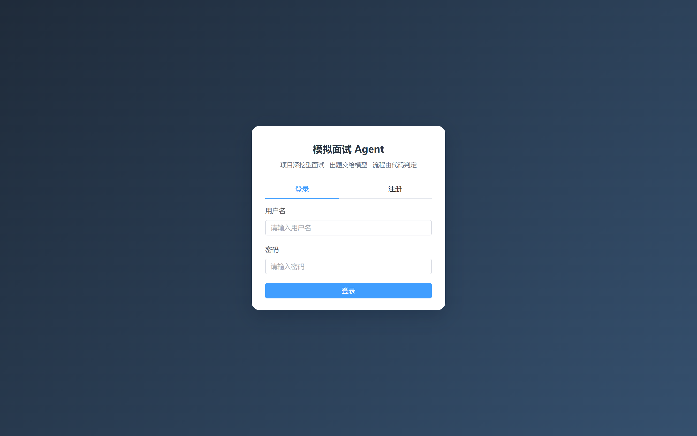
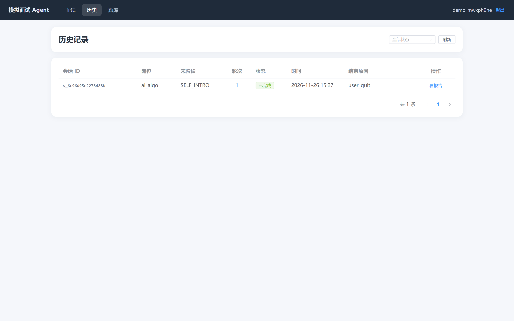
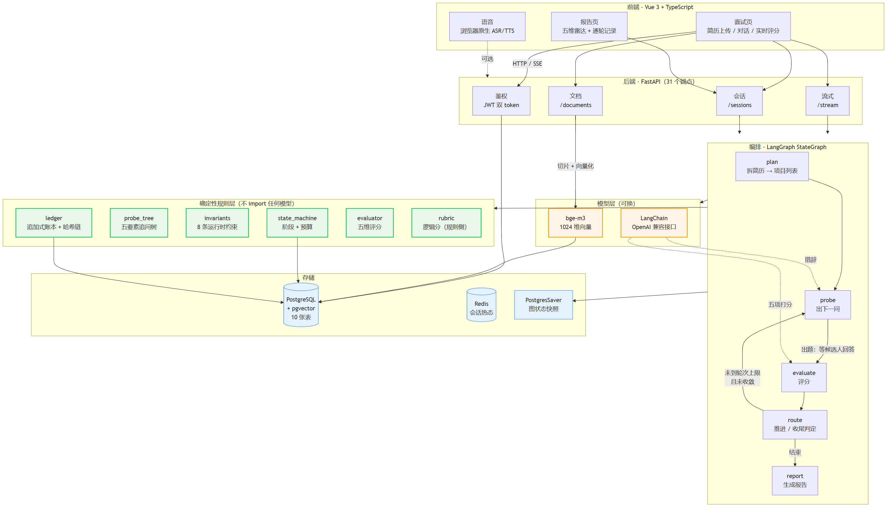
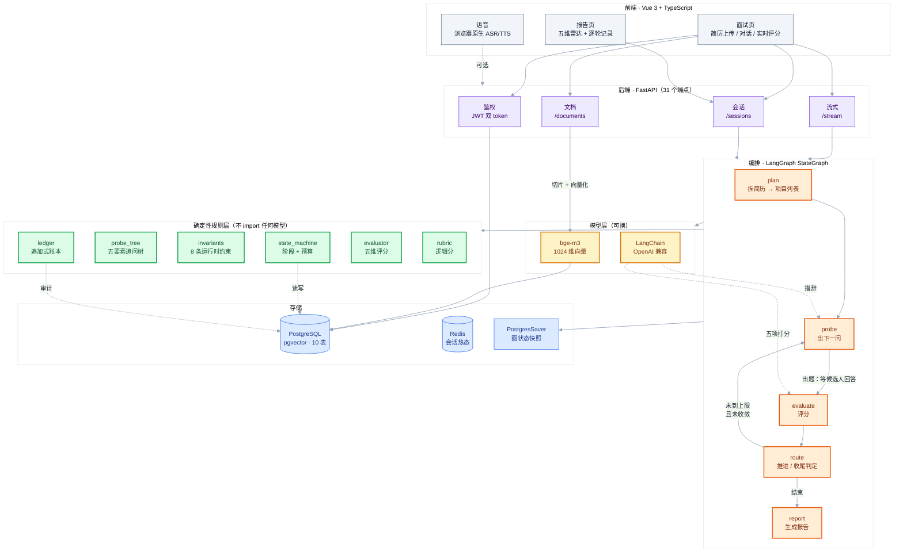

# 模拟面试 Agent

[](https://github.com/LiQingfeng111/interview-agent/actions/workflows/ci.yml)
[](https://www.python.org/)
[](https://vuejs.org/)
[](LICENSE)

> 一个**项目深挖型**的模拟面试系统：状态机控制节奏，简历驱动追问，五维打分可回溯。

不是"跟 AI 聊天的面试机器人"。核心区别在于：**出题节奏由代码决定，模型只负责措辞。**

**跑起来后打开** → http://localhost:5173 （本机开发） / http://localhost:8081 （Docker）
详见 [快速开始](#快速开始)。

---

## 界面一览

<table>
<tr>
<td width="50%">

**① 登录**

JWT 双 token：access 15 分钟在内存（防 XSS 偷走），
refresh 7 天在 HttpOnly Cookie（JS 读不到）。



</td>
<td width="50%">

**② 面试配置**

上传简历 → 自动切片 + 向量化 → 就绪后按钮才可点。


</td>
</tr>
<tr>
<td>

**③ 上传进度**

六阶段人话反馈，用户永远知道现在在干什么。

上传 → 已收到 → 解析中 → 向量化 3/8 → 就绪


</td>
<td>

**④ 面试对话**

左侧实时进度 / 阶段 / 追问层级，右侧问答气泡带评分徽标。


</td>
</tr>
<tr>
<td>

**⑤ 报告**

五维雷达 + 分维度条形 + Markdown 报告 + token 成本。

雷达图数据来自 `turns` 表的独立列（不是 JSON），能按维度聚合。


</td>
<td>

**⑥ 题库**

722 道题，46 个话题。检索 = **topic 精确过滤 + 语义排序**
（同话题命中率 100%，实测见下方「检索」章节）。


</td>
</tr>
<tr>
<td>

**⑦ 历史**

往期面试记录，可回看报告。



</td>
<td>

**⑧ 移动端**

响应式布局，未做专门适配但可用。


</td>
</tr>
</table>

> 这些截图是**脚本自动生成**的：`node frontend/scripts/screenshot.mjs`
> UI 改了重跑一次就更新，不会忘记同步文档。

---

## 为什么做这个

市面上的 AI 模拟面试，问题高度雷同：

| 常见做法 | 问题 |
|---|---|
| 一个大模型 + 一段提示词 | 问完第一题就开始重复；问到哪儿了不知道 |
| 模型自己决定问什么 | 说不清"为什么问这题"，也没法验证改进了没有 |
| 只给一个总分 | "3.5 分"没有信息量，不知道弱在哪 |

**这个项目的取舍**：把"节奏"和"判断"交给确定性代码，把"措辞"交给模型。

```
候选人的一句话
    │
    ├─→ 状态机：现在该问什么阶段（开场/项目深挖/技术问答/反问）
    ├─→ 追问树：这个项目还有哪 3 个要素没问到（目标/基线/指标/失败方案/个人贡献）
    ├─→ 难度梯子：当前停在第几层（是什么/为什么/怎么做/取舍/边界/反事实）
    └─→ 检索：简历里相关的片段、题库里语义相近的题
            │
            └─→ 模型：把以上约束写成一句人话
```

**这样做的代价**：写得比"一个提示词"复杂得多。
**换来的好处**：每条追问都能解释"为什么问这个"，每一分都能追溯到具体维度。

---

## 架构总览

### 一张图看完整个系统



> 下面还有 Mermaid 版本（GitHub 上会渲染成可交互的图）。



**看图要点**：

- **绿框（规则层）不 import 黄框（模型层）** —— 这是整个设计的支点。
  规则层能在测试里稳定跑，所以"为什么问这题"可以被验证。
- **只有两个地方调模型**：`probe`（写措辞）和 `evaluate`（打分）。
  其余全是确定性代码。
- **`route` 是 Agent loop 的关键**：它决定"继续问"还是"收尾"。

### 每一部分用什么技术

| 环节 | 技术 | 具体做什么 | 为什么用它 |
|---|---|---|---|
| 服务入口 | FastAPI 0.165 | 31 个 REST 端点 + SSE | OpenAPI 自动生成，异步友好 |
| 会话编排 | LangGraph 1.2 | `StateGraph` 5 节点 | 条件分支/循环用图表达比手写 while 清楚，且能持久化 |
| 状态持久化 | PostgresSaver | 每步存快照 | 进程被杀后能从第 N 轮续跑（实测重启续跑成功） |
| 会话热态 | 进程内存 + Redis | 当前 runtime 对象 | 避免每轮都重建对象；多实例时换 Redis |
| 结构化存储 | PostgreSQL 16 | 10 张表（users/sessions/turns/reports/…） | 关系 + 向量一套搞定 |
| 向量检索 | pgvector 0.8 + HNSW | 1024 维，余弦距离 | 不用额外装 ES/Milvus |
| 向量化 | bge-m3（1024 维）| 中文语义强，同义改写 ≈0.70 | 实测 topic 过滤后同话题命中 100%（见下方检索章节） |
| 模型接入 | LangChain + OpenAI 兼容 | `chat` / `chat_json` | 换模型只改 base_url + model |
| 规则：阶段 | `state_machine.py` | 开场→深挖→技术→反问→反馈，带预算 | 阶段和轮次必须可预测 |
| 规则：追问 | `probe_tree.py` | 五要素树，每要素最多试 2 次 | 防止绕着一个点死问 |
| 规则：约束 | `invariants.py` | 8 条不变量（证据必须是原文子串等） | 拦住模型的编造 |
| 规则：审计 | `ledger.py` | 追加式 + 哈希链 | 记录不可篡改，可验证 |
| 规则：评分 | `rubric.py` | 数字/基线/边界/结构词检测 | 让分数有客观锚点，不漂移 |
| 鉴权 | PyJWT | access 15min 内存 / refresh 7d HttpOnly | 防 XSS 偷 token + 静默续期 |
| 前端 | Vue 3 + Element Plus | 6 个页面 | 组合式 API + 类型安全 |
| 部署 | Docker Compose | 4 服务 | 一条命令起全栈 |

### Agent Loop 怎么写（核心）

**不是 `while True: 问 + 答`**，而是一张带条件边的图：

```python
# backend/app/graph/interview_graph.py（节选，已简化）

from langgraph.graph import StateGraph, END

g = StateGraph(InterviewState)

g.add_node("plan",     node_plan)      # 拆简历，得到项目列表
g.add_node("probe",    node_probe)     # 出下一问
g.add_node("evaluate", node_evaluate)  # 评上一答
g.add_node("route",    node_route)     # 决定继续 / 收尾
g.add_node("report",   node_report)    # 生成报告

# ── 入口是条件的：第一次进来先 plan，之后直接 probe ──
#
# 为什么不能固定从 plan 进：每轮 invoke 都跑一次 plan 会让 turn 卡在 0
# （踩过这个坑）。用条件入口后，sessions 表里的 projects 为空才走 first。
g.set_conditional_entry_point(
    _entry_point,                      # 返回 "first" 或 "next"
    {"first": "plan", "next": "probe"},
)

g.add_edge("plan", "probe")

# ── 关键：probe 之后是 END，不是 evaluate ──
#
# 一"轮"跨越两次 HTTP 请求：
#   请求 1（POST /sessions）：plan → probe → END，返回第一问
#   请求 2（POST /answer）  ：evaluate → route → probe → END，返回评分+下一问
#
# 这样用户答题的时间不计入任何超时，也不会占着一个长连接。
g.add_edge("probe", END)

g.add_edge("evaluate", "route")

# ── 循环在这里：route 决定回 probe 还是去 report ──
g.add_conditional_edges(
    "route",
    _after_route,                      # 返回 "continue" 或 "finish"
    {"continue": "probe", "finish": "report"},
)

g.add_edge("report", END)

app = g.compile(checkpointer=PostgresSaver(...))
```

**判定逻辑（`_after_route` 做什么）**：

```python
def _after_route(state) -> str:
    """返回 "continue" 或 "finish"。纯规则，不调模型。"""
    turn      = state["turn"]            # 已答轮次
    max_turns = state["max_turns"]       # 轮次上限
    phase     = state["phase"]           # 当前阶段

    # ① 到上限 → 收尾
    if turn >= max_turns:
        return "finish"

    # ② 走到最后一个阶段（反馈）→ 收尾
    if phase == "FEEDBACK":
        return "finish"

    # ③ 追问树所有要素已覆盖，且题库也问过 → 提前收尾
    #    （不让用户干等到轮次上限）
    if state.get("elements_done") and state.get("tech_done"):
        return "finish"

    return "continue"
```

**三种收尾条件**：轮次上限、阶段走完、要素+题库都覆盖了。
所以一场面试可能 8 轮结束，也可能 16 轮，取决于候选人答得多实。

### 评分怎么来的（双轨）

```
候选人回答
    │
    ├─→ 模型评分（evaluate 节点）
    │   输入：当前问答 + 最近 6 轮历史 + 简历相关片段 + 评分锚点
    │   输出：accuracy/depth/tradeoff/boundary/clarity 五项 + repeated/consistent
    │
    ├─→ 逻辑评分（rubric.py，零成本确定性）
    │   accuracy  ← 数出了几个具体数字、有没有基线、套话密度、与简历是否矛盾
    │   boundary  ← 数有没有"只在…时""不适用""失效"这类词
    │   clarity   ← 数结构词（首先/因为/所以）、平均句长
    │
    └─→ 按维度加权融合
        accuracy = 模型×0.4 + 规则×0.6    ← 数字在不在是客观的，规则更可靠
        boundary = 模型×0.6 + 规则×0.4    ← "透不透"要模型判断
        clarity  = 模型×0.3 + 规则×0.7    ← 结构词/句长可量化
        depth     = 纯模型                ← 规则算不了
        tradeoff  = 纯模型                ← 规则算不了
                  │
                  └─→ avg = 五维平均
                        │
                        └─→ verdict 由阈值裁决（不采信模型自己给的 verdict）
                            real: ≥2.8 pass / ≥1.6 partial / <1.6 fail
```

**为什么双轨**：单靠模型会漂移（同答案两次可能 2.5/3.0），也会被话术骗；
单靠规则判断不了"讲得深不深"。分工后，规则负责"别被空话骗"，
模型负责"别把有料的话判死"。

**规则有下限**（`RULE_FLOOR = 1.5`）：候选人说"数据保密，我只讲方法"时，
规则不该给 1 分。这条保护的是"诚实但没数字"的回答。

### 历史上下文怎么进评分（实测证明它真的起作用）

同一句话「召回从 71% 提到 82%，代价是索引体积增加 30%，P99 延迟 1.8 秒」：

| 历史 | repeated | accuracy | depth | **avg** |
|---|---|---|---|---|
| 上一轮**一字不差**说过 | true | 2 | 1 | **2.60** |
| 历史**完全无关** | false | 4 | 3 | **3.60** |

**同一个答案因上下文不同差了 1.0 分。**

机制是"双保险"：

1. **提示词**要求模型判断 `repeated` / `consistent`，并给了指代消解规则
   （"前面那个方案"要从历史里找出具体指代）
2. **规则侧**也算一遍 3-gram Jaccard 相似度（阈值 0.5），
   任一判重就扣 `accuracy`/`depth` 各 1 分

为什么要规则兜底：弱模型会忽略历史（提示词约束不住）。
实测过一次：规则侧能准确认出"一字不差"，而模型侧直接给了 `repeated=false`。

---

## 技术栈

| 层 | 选型 | 为什么 |
|---|---|---|
| 后端 | Python 3.12 + FastAPI | 异步友好，OpenAPI 自动生成 |
| 编排 | LangGraph（`StateGraph` + `PostgresSaver`） | 会话状态持久化，进程重启能续跑 |
| 模型 | LangChain + OpenAI 兼容接口 | 模型可换（本地/云端），不强绑一家 |
| 向量 | PostgreSQL + pgvector + bge-m3 | 一套库解决关系 + 向量，不用额外装 ES |
| 缓存 | Redis | 会话热态、限流 |
| 前端 | Vue 3 + TypeScript + Element Plus | 组合式 API，类型安全 |
| 部署 | Docker Compose | 一条命令起全栈 |

**核心逻辑与模型解耦**：`state_machine.py` / `probe_tree.py` / `invariants.py` /
`ledger.py` / `evaluator.py` 都是纯 Python，不 import 任何模型客户端。
这样规则层能在测试里稳定跑，也是"为什么问这题"能被解释的前提。

---

## 快速开始

### 前置

- Docker（跑 PostgreSQL + Redis）
- Python 3.12
- Node.js **22+**（`undici` / `vitest` 的要求；Node 20 会崩）
- （可选）[Ollama](https://ollama.com/) 跑本地向量模型 `bge-m3`

### 三行命令

```bash
# 1. 装依赖
python3 -m venv .venv && .venv/bin/pip install -r backend/requirements.txt
cd frontend && npm install && cd ..

# 2. 配环境（只需要填 LLM_API_KEY）
cp .env.example .env

# 3. 启动
bash start.sh
```

### 起来之后打开哪个地址 ← **看这里**

启动完访问 **http://localhost:5173**（前端界面）。

**默认账号**（首次启动自动创建，不用注册）：

```
用户名：demo
密码：  demo123456
```

> 这个账号是**写进代码的**（`backend/app/core/bootstrap.py`），
> 后端每次启动都会检查：不存在就创建，已存在就**不动**。
> 所以哪怕数据库重置，重启一次它又回来了。
>
> 想改：在 `.env` 里设 `IA_DEMO_USER` / `IA_DEMO_PASSWORD`。
> 想关掉：两者都留空。生产环境（`IA_ENV=production`）会自动拒绝创建。

| 地址 | 是什么 | 什么时候用 |
|---|---|---|
| **http://localhost:5173** | **前端界面** | **平时用这个** |
| http://localhost:8080/docs | 后端 API 文档（Swagger） | 想直接调接口、看有哪些端点 |
| http://localhost:8080/api/health | 健康检查（JSON） | 排查问题：各组件是否就绪 |

**端口分配**（两个模式不一样，别混）：

| 模式 | 前端 | 后端 |
|---|---|---|
| 本机开发（`bash start.sh`） | **5173** | 8080 |
| Docker 全栈（`docker compose up`） | **8081** | 8080 |

> Docker 里前端是 8081（容器内 Nginx 的 80 映射出来），
> 本机开发是 Vite 的 5173。两个同时跑不会冲突。

**改端口**：

```bash
IA_PORT=9000 bash start.sh api          # 后端改 9000
cd frontend && npm run dev -- --port 3000   # 前端改 3000
```

前端开发时通过 Vite proxy 转发 `/api` 到 `127.0.0.1:8080`（见 `frontend/vite.config.ts`），
所以前端改端口不影响后端连通；但**后端改端口时要同步改 vite 的 proxy target**。

### 启动过程中会发生什么

`start.sh` 按顺序做这些事，每步都有输出：

```
▸ 环境体检      Python / 依赖 / Ollama / 密钥
▸ PostgreSQL    起容器（首次会创建）→ 等就绪
▸ 后端 API      建表 → 导入题库 722 题（约 18 秒）→ 起 uvicorn
▸ 前端          检查依赖 → 提示在 Windows 侧启动
```

**Windows 用户**：双击 `start.bat`（会调 `start.sh` 并额外开窗口跑前端，最后自动打开浏览器）。

### 遇到问题

```bash
bash start.sh check     # 环境体检（不动任何东西）
bash start.sh status    # 看服务状态和数据量
bash start.sh stop      # 停掉后端和前端
```

体检输出示例：

```
▸ 环境体检
  ✓ Python venv: Python 3.12.3
  ✓ 后端依赖已装
  ! PostgreSQL 容器存在但未运行（start.sh 会自动启动）
  ✓ Ollama（172.22.48.1:11800）
  ✓ 模型网关（172.22.48.1:18336）
  ✓ LLM_API_KEY 已配置
  ✓ 前端依赖已装
  基础环境就绪，可以 bash start.sh
```

---

## 页面清单

截图已集中在上方「界面一览」，这里是功能说明。

| 页面 | 说明 |
|---|---|
| 登录 / 注册 | JWT 双 token（access 15 分钟在内存，refresh 7 天在 HttpOnly Cookie） |
| 面试 | 左：简历上传 + 配置；右：对话 + 实时评分 |
| 报告 | 五维雷达图 + 逐轮记录 + 成本 |
| 历史 | 往期面试列表，可回看报告 |
| 题库 | 722 题检索（纯语义） |
| 管理 | 用户管理、阈值调参、RAG 诊断 |

**几个实现细节**：

- **简历上传六阶段反馈**：用户永远知道现在在干什么，不会以为卡住而反复点。
- **语音**：浏览器原生 ASR/TTS（Chrome/Edge 零延迟、免费、内容不外传），后端留了 Whisper/edge-tts 作为 Firefox 兜底。
- **评估模式**：勾选后每轮回答完显示「扣分点 / 缺什么 / 建议 / 可以这样说」。
- **报告 Markdown 渲染带 XSS 清洗**：报告是模型生成的，属于不可信输入，直接 `v-html` 会被注入。用 marked + DOMPurify，8 条测试覆盖常见 payload。
- **截图脚本自动生成**：`node frontend/scripts/screenshot.mjs`，UI 改了重跑一次就更新。

---

## 设计上几个关键决定

### 1. 判定权在阈值，不在模型

模型会返回一个 `verdict`（pass / partial / fail）。但**我们不用它**。

```python
# 阈值说话
if avg >= 2.8:   verdict = "pass"        # real 模式
elif avg >= 1.6: verdict = "partial"
else:            verdict = "fail"

# 模型的判定只留档，用来发现"尺子和模型不一致"
model_verdict = llm_output["verdict"]
if model_verdict != verdict:
    flag("verdict_conflict")   # 提示词或阈值需要复核
```

**为什么**：模型的判定会漂移（同样答案两次可能一个 pass 一个 partial）。
留档冲突是为了**发现问题**，不是让它参与决策。

### 2. 检索用"topic 精确过滤 + 语义排序"，不做关键词混合，也不做 rerank

这一节记录三次判断的过程，因为**结论和我最初的判断完全相反**。

#### 第一版结论（错）

试过三种，在同一批 18 条查询上测：

| 方案 | 命中 |
|---|---|
| 纯向量（bge-m3） | 17 / 18 |
| 纯关键词 | 7 / 18 |
| RRF 混合 | 10 / 18 |

当时结论：「RRF 反而更差，关键词拖后腿，只留向量」。

**这个结论有三个缺陷**：
1. 语料只有 `18 个目标 + 5 个干扰 = 23 条` —— 干扰太少，任何方法都容易得高分
2. 只做到 RRF 就停了，没做 rerank（标准链路是 召回→融合→精排→截断）
3. 用的是**等权** RRF，把 7/18 的弱信号掺进 17/18 的强信号

#### 换成真实题库 740 条后

| 类型 | 23 条语料 | 740 条语料 |
|---|---|---|
| 字面/术语 | 6/6 | 6/6 |
| 同义改写 | 5/6 | **1/6** |
| 中英对照 | 6/6 | **2/6** |
| **合计** | **17/18** | **9/18** |

于是去查"瓶颈在哪"，得到：

```
recall_k=50 覆盖率        16/18（89%）  ← 目标都捞进来了
从 50 条选 top-3           9/18（50%）  ← 但排不进前三
```

结论：「瓶颈在精排，该上 rerank」。

#### 精排也测了（还是错）

| 方案 | 结果 |
|---|---|
| 词面 rerank（IDF/位置/短语，6 种组合） | 全部比基线**差 4 个点** |
| 细粒度向量精排（切句取最大相似度） | **18 条逐条相同，0 点变化** |

同一个模型换粒度得到完全相同的排序 —— 说明问题在更前面。

#### 真正的根因

去看生产代码实际怎么查的（`interview_graph.py:247`）：

```python
topic = _tech_topic_of(state)          # 状态机给的话题名，如 "RAG"
query = topic or state.get("current_project", "")
```

**生产查询是话题名，不是我评测集里那些口语问句。**

而标为 `topic='RAG'` 的题，题干问的是：

```
"chunk 大小和切分策略你会怎么定？"
"多路召回后用 RRF 融合，k 取 60 是默认还是有调过？"
"增量索引怎么保证不出现同一段内容的两个版本同时被召回？"
```

**这些题是对的 RAG 题，但题干里没有 "RAG" 这个词。**

全库统计（题干含话题词的比例）：

| topic | 比例 |
|---|---|
| **RAG** | **2/8 = 25%** |
| **Transformer** | **1/5 = 20%** |
| Agent | 8/8 = 100% |
| 评测 | 6/7 = 86% |

题库里一直有 `topic` 字段，但代码只拿它做「话题配额加权」，
**从没用来做「精确过滤」**。

#### 修复：一行 SQL

```python
if topic:
    conds.append("topic = %s")
```

效果（37 个话题，看 top-10 里同话题占比）：

| 方案 | 同话题占比 | 全中话题 | 全错话题 |
|---|---|---|---|
| 纯向量 k=10（原实现） | 47% | 5/37 | 2/37 |
| 纯向量 k=30（只放宽召回） | **33%** | 0/37 | 2/37 |
| **topic 过滤 + 向量 k=10** | **100%** | **36/37** | **0/37** |

改善明显的：`Agent 工具调用` 3/10 → 10/10，`前端性能` 2/10 → 10/10，
`评估体系` 5/10 → 10/10。

**注意第二行：放宽召回反而更差。** 因为话题分布不均
（"上下文工程" 33 道 vs "Git 协作" 1 道），扩大召回时大类会挤占小类名额。

#### 混合检索和 rerank 的代码保留但不启用

`backend/app/rag/hybrid.py`（BM25 + RRF）和 `backend/app/rag/rerank.py`
（cross-encoder）已实现并有 27 条测试，但**生产链路不 import**。

保留的理由：题库扩到万级、或查询变成候选人整段回答时，它们会有价值。
不启用的理由：当前 722 题 / 46 话题，topic 过滤后每话题 1-33 道，
语义排序足够；而精排救不回"没被召回"的内容。

完整数据与三次误判的复盘见 [`docs/RETRIEVAL-EXPERIMENT.md`](docs/RETRIEVAL-EXPERIMENT.md)。

### 3. 阈值按"用途"分，不按"索引"分

同一份向量，不同用途的相似度分布不一样：

| 用途 | 阈值 | 理由 |
|---|---|---|
| 去重 | 0.60 | 判定"是不是同一题"，要严 |
| 选题 | 0.42 | 判定"够不够相关"，可以松 |
| 提示 | 0.42 | 同上 |

bge-m3 的分布很保守：同义改写约 0.70，不相关约 0.40，**正负样本间隔只有 0.022**。
所以阈值必须实测标定，不能拍脑袋。

### 4. 重启能续跑

会话状态用 `PostgresSaver` 持久化。进程被杀后重启，从**第 3 轮**继续，不是从 0 开始。

实测：

```
前 3 轮: tokens=802  calls=7
━━━ 杀进程 → 重启 ━━━
后 3 轮: tokens=1504 calls=13   ← 跨重启累积正确
```

### 5. 反问环节不参与技术评分

`CANDIDATE_ASK` 阶段问的是"你有哪些想问我的？"，候选人说的是**提问**，不是技术回答。
用 `accuracy/depth/tradeoff/boundary/clarity` 这套维度评它没有意义。

**E2E 实跑暴露的两个连锁 bug**（都是同一个根因：没区分"评分"和"记录"）：

| 现象 | 原因 | 修复 |
|---|---|---|
| 反问轮 `fail 1.9` 拉低均分 | 一视同仁走技术评分 | `verdict="n/a"`，统计时跳过 |
| **同一句话问了 4 次** | 提前 return 没调 `sm.record()` → `turn_in_phase` 不累加 → 阶段推不动 + 下一轮拿不到 history | 短路后**仍 record** |

修复后实测（12 轮上限）：

```
第 1-8 轮   正常评分  partial=5 fail=3
第 9 轮     n/a       （反问，问完即收尾）
均分        2.08      ← 只统计 8 轮，反问不参与
```

报告里这一轮**仍然展示**（标题写"反问环节，不计分"），不能凭空消失 ——
否则读者会以为漏了一轮。但它不进结论分布、不进雷达图、不会被选为"最需要复盘的"。

**这条能守住的关键**：`test_candidate_ask.py` 用 mock 验证
`sm.record()` 被调用。第一版修复时我只改了评分、没改记录，
E2E 立刻发现——单元测试容易漏掉"该调没调"这类缺陷，端到端跑一次才暴露。

---

## 项目结构

```
interview_agent/
├── start.sh / start.bat      ← 唯一入口
├── ops.sh                    ← 运维（db/schema/bank/api/status/e2e/test）
├── *.py                      ← 规则层（零依赖，可单独测试）
│   ├── state_machine.py        阶段推进
│   ├── probe_tree.py           追问要素树
│   ├── invariants.py           8 条运行时约束
│   ├── ledger.py               追加式账本 + 哈希链
│   ├── evaluator.py            五维评分
│   └── interviewer.py          措辞生成
│
├── backend/
│   ├── app/
│   │   ├── api/                FastAPI 路由（31 个端点）
│   │   ├── graph/              LangGraph 编排
│   │   ├── rag/                检索（embedder/splitter/retriever/记忆）
│   │   │   ├── hybrid.py         BM25 + RRF（**未启用**，见检索章节）
│   │   │   └── rerank.py         cross-encoder（**未启用**）
│   │   ├── repos/              PG + Redis
│   │   └── core/               运行时/自检/成本/双轨评分
│   └── tests/
│       ├── ready.py            就绪判定（PG + 向量 + 向量服务三条件）
│       ├── e2e_full.sh         完整端到端（注册→上传→面试→报告）
│       └── ...                 156 条测试
│
├── tools/
│   ├── preflight.sh            环境自检（基础设施/依赖/数据 三层）
│   ├── run_py.sh               跑脚本前自动修好 PG/Ollama
│   ├── pg_backup.sh            数据库备份/恢复
│   └── create_user.sh          建/验证账号
│
├── frontend/
│   └── src/                    Vue 3（19 文件）
│
├── docs/                       设计文档（见下）
└── legacy/                     已废弃的旧架构（不入库）
```

**规模**：约 17,000 行（规则层 7,476 / 后端 6,542 / 前端 3,018）

---

## 测试

```bash
pytest                    # 411 passed, 1 skipped
cd frontend && npm test   # 18 passed
```

| 层 | 条数 | 需要什么 |
|---|---|---|
| 规则层 `tests/` | 343 | 只需 Python（不连数据库/模型） |
| 后端 `backend/tests/` | 68 | PostgreSQL；检索测试需要 Ollama |
| 前端 `frontend/src/**/*.test.ts` | 18 | Node |

覆盖的重点：

- **规则层不依赖模型**：状态机、追问树、不变量、账本校验都是纯函数，好测
- **鉴权**：篡改 token / 换密钥签 / 过期 / access-refresh 混用 —— 全部必须被拒
- **阈值回归**：检索阈值有一组固定的查询/期望，改动会立刻发现
- **重启恢复**：`test_restart_recovery.sh` 真的杀进程再续跑

CI（`.github/workflows/ci.yml`）跑三组独立 job：规则层 / 后端（带 PostgreSQL service）/ 前端（类型检查 + 测试 + 构建）。

---

## 已知限制

诚实列出来，不粉饰：

| 项 | 原因 | 影响 |
|---|---|---|
| 后端 ASR 需联网下模型 | Whisper 模型 140MB，当前网络取不到 | Firefox 无语音输入（Chrome/Edge 用浏览器原生） |
| 成本是估算值 | 从 LLM logger 读 usage，并发会话可能串账 | 数字有偏差，量级正确 |
| 移动端未适配 | 只测了桌面浏览器 | 手机上布局会错位 |
| 单进程部署 | 会话热态在进程内存 | 多实例需要把热态换到 Redis |

---

## 文档

| 文档 | 内容 |
|---|---|
| [PRODUCT-PLAN.md](docs/PRODUCT-PLAN.md) | 产品定位与路线 |
| [API-CONTRACT.md](docs/API-CONTRACT.md) | 31 个端点的契约 |
| [ERROR-DESIGN.md](docs/ERROR-DESIGN.md) | 错误码设计（40xxx–5xxxx） |
| [PROMPT-TEMPLATES.md](docs/PROMPT-TEMPLATES.md) | 提示词模板与为什么这么写 |
| [DEDUP-RESEARCH.md](docs/DEDUP-RESEARCH.md) | 检索方案对比实验 |
| [ARCHITECTURE-MAP.md](docs/ARCHITECTURE-MAP.md) | 架构地图 |
| [backend/docs/](backend/docs/) | 各阶段实现报告（含踩坑记录） |

---

## 许可

MIT
